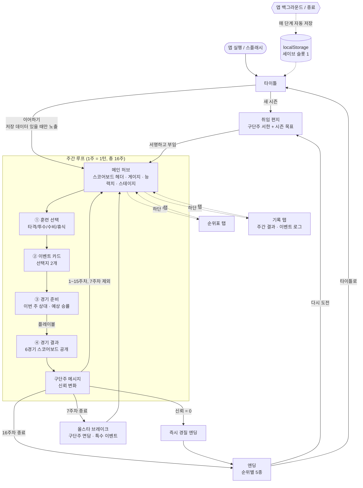

# 03 — UI/UX 설계: 독이 든 성배

> 작성: 게임 UI/UX 디자이너 · 기준 문서: `00-brief.md`
> 기준 해상도: 세로 390×844pt (iPhone 14/15 계열). 최소 360×640, 최대 430×932까지 같은 레이아웃이 늘어나고 줄어든다.
> 비주얼 컨셉: **옛 야구장 수동식 스코어보드**. 짙은 녹색 판 위에 분필색 글씨, 주황 전구, 꼴찌를 뜻하는 빨강.

---

## 0. 설계 원칙 (요약)

1. **화면 전체가 하나의 스코어보드다.** 모든 화면은 녹색 판 위에 "숫자판(패널)"을 끼워 넣는 구조로 만든다. 카드, 모달, 탭 모두 같은 판 재질 위에 놓인다.
2. **한 주 = 한 화면 흐름, 버튼 하나씩.** 주간 루프의 각 단계는 화면 하단의 큰 CTA 버튼 하나로 다음 단계로 넘어간다. 한 손 엄지만으로 16주를 끝낼 수 있어야 한다.
3. **숫자가 주인공이다.** 신뢰·팬·사기·예산·능력치·승패는 언제나 같은 위치, 같은 고정폭 숫자 서체로 표시한다. 변할 때는 전광판처럼 넘어간다.
4. **효과는 미리 보여 준다.** 이벤트 선택지와 훈련 버튼에는 결과 수치(예: `신뢰 +4 · 예산 −3억`)를 선택 전에 표시한다(브리프 요구사항).
5. **블랙코미디는 텍스트로, 긴장은 숫자로.** 일러스트는 최소화하고, 구단주 메시지·이벤트 문구의 말맛과 전광판 연출로 감정을 만든다.

---

## 1. 화면 흐름도



### 흐름 규칙

| 항목 | 규칙 |
|---|---|
| 자동 저장 | 단계 전환(훈련 확정 → 이벤트 선택 → 경기 결과 확정) 시점마다 저장. 경기 결과는 **시뮬레이션 후 저장하고 나서** 공개 애니메이션을 재생한다. 그래야 앱을 껐다 켜서 결과를 다시 뽑는 세이브 스컴이 안 된다. |
| 이어하기 | 타이틀에서 저장 슬롯이 있으면 `이어하기`를 1순위(주황 CTA)로, `새 시즌`을 2순위(외곽선)로 둔다. 새 시즌을 누르면 "현재 시즌을 버리시겠습니까?" 확인을 띄운다. |
| 탭 이동 | 순위표/기록 탭은 **허브 상태에서만** 이동 가능. 훈련~결과 단계 중에는 하단 탭을 반투명 처리하고 잠근다(진행 중인 선택을 잃지 않도록). |
| 올스타 | 8주차 시작 전에 끼워 넣는 전면 이벤트. 일반 이벤트 카드보다 큰 "면담실" 레이아웃이고 선택지는 3개까지 허용한다. |
| 경질 | 신뢰가 0이 되는 순간 구단주 메시지 대신 빨간 "경질 통보" 전보 화면을 띄운 뒤 엔딩으로 간다. |

---

## 2. 화면별 와이어프레임 (390×844 기준)

> 표기: `[ ]` 버튼, `( )` 선택 상태, `●○` 전구(켜짐/꺼짐), `▓░` 게이지, `▲▼` 증감.
> 가로 1칸 ≈ 9.75pt (40칸 = 390pt). 한글은 2칸을 차지한다.

### 2-1. 타이틀

```
┌────────────────────────────────────────┐
│ ▒▒▒▒▒▒▒▒▒ 상태바 / 세이프에어리어 ▒▒▒▒▒▒▒▒▒ │
│                                        │
│        ● ● ● ● ● ● ● ● ● ● ●           │
│                                        │
│            독 이  든  성 배             │
│        ━━━━━━━━━━━━━━━━━━━━━━          │
│        반월 펠리컨스 감독 잔혹사        │
│                                        │
│              ┌────────┐                │
│              │  🏆☠   │  ← 금 간 성배   │
│              │ (성배)  │    엠블럼      │
│              └────────┘                │
│                                        │
│   ┌──────────────────────────────┐     │
│   │ 최근 7시즌  10 10 10 10 10 10 10│     │
│   │ 최근 5년 경질 감독      6명    │     │
│   └──────────────────────────────┘     │
│                                        │
│                                        │
│                                        │
│  ┌──────────────────────────────────┐  │
│  │      이어하기  ·  9주차 8위       │  │ ← 주황 CTA
│  └──────────────────────────────────┘  │   (저장 있을 때)
│  ┌──────────────────────────────────┐  │
│  │           새 시즌 시작            │  │ ← 외곽선 버튼
│  └──────────────────────────────────┘  │
│     설정      ·      크레딧      v0.1  │
│ ▒▒▒▒▒▒▒▒▒ 홈 인디케이터 영역 ▒▒▒▒▒▒▒▒▒▒ │
└────────────────────────────────────────┘
```

- 7시즌 순위 `10`은 빨간 숫자판으로 하나씩 "탁탁" 넘어가며 켜진다(첫 실행 1회, 이후 즉시 표시).
- 저장이 없으면 `새 시즌 시작`이 주황 CTA로 올라오고 이어하기 버튼은 렌더링하지 않는다.

### 2-2. 메인 허브

```
┌────────────────────────────────────────┐
│ ▒▒▒▒▒▒▒▒▒ 상태바 / 세이프에어리어 ▒▒▒▒▒▒▒▒▒ │
│┌──────────────────────────────────────┐│
││ WEEK [0][9]/16   RANK [0][8]  ⚙      ││ ← 스코어보드 헤더
││ 반월 펠리컨스   W [2][5]  L [2][9]    ││   (고정, 56pt)
│└──────────────────────────────────────┘│
│                                        │
│  구단주 신뢰  ●●●●●●○○○○  58  ▲3     │ ← 전구 게이지 10칸
│  팬 민심      ●●●○○○○○○○  27  ▼2     │   (값/10 반올림)
│  선수단 사기  ●●●●○○○○○○  41  ▲1     │   30 미만 = 빨간 전구
│  예산         [ 2 4 ] 억              │
│                                        │
│  ┌────────┬────────┬────────┐          │
│  │  타격  │  투수  │  수비  │          │ ← 능력치 숫자판
│  │  [47]  │  [43]  │  [42]  │          │
│  │ ▓▓▓▓░░ │ ▓▓▓░░░ │ ▓▓▓░░░ │          │
│  └────────┴────────┴────────┘          │
│  우리 전력 44.3  ·  가을야구 공약 ☐     │
│ ────────────────────────────────────── │
│  이번 주 진행  ● 훈련 ─ ○ 사건 ─ ○ 경기 │ ← 스테이지 표시
│                                        │
│  ┌──────────────────────────────────┐  │
│  │ 훈련을 고르세요            ①/③   │  │ ← 스테이지 카드
│  │ ┌─────────────┐┌─────────────┐   │  │   (현재 단계 내용이
│  │ │ 타격 특훈    ││ 투수 집중    │   │  │    여기 교체됨)
│  │ │ 타격+3 사기−2││ 투수+3 사기−2│   │  │
│  │ └─────────────┘└─────────────┘   │  │
│  │ ┌─────────────┐┌─────────────┐   │  │
│  │ │ 수비 펑고    ││ 휴식·회복    │   │  │
│  │ │ 수비+3 사기−2││ 사기 +8      │   │  │
│  │ └─────────────┘└─────────────┘   │  │
│  └──────────────────────────────────┘  │
│  ┌──────────────────────────────────┐  │
│  │          훈련 확정  ▶             │  │ ← 주황 CTA (52pt)
│  └──────────────────────────────────┘  │
│┌──────────┬──────────┬──────────┐      │
││  ⚾ 허브  │ 📊 순위표 │ 📜 기록  │      │ ← 하단 탭 (56pt)
│└──────────┴──────────┴──────────┘      │
│ ▒▒▒▒▒▒▒▒▒ 홈 인디케이터 영역 ▒▒▒▒▒▒▒▒▒▒ │
└────────────────────────────────────────┘
```

- **헤더(고정)**: 주차·순위·승패를 2자리 숫자판으로 표시. 순위 10위는 숫자판 배경이 빨강, 1–5위(가을야구권)는 숫자판 테두리가 주황.
- **게이지**: 0–100 값을 전구 10개로 표시하고 정확한 숫자를 옆에 둔다. 지난주 대비 증감(▲▼)은 한 주 동안 남긴다.
- **능력치 바**: 20–90 범위를 막대로 정규화. 70 초과 구간은 바 위에 얇은 주황 눈금으로 "효율 저하(+1)" 구간을 표시한다.
- **스테이지 카드**: 허브 하단 절반이 단계별로 바뀌는 무대다. 훈련 → 이벤트 → 경기 준비 → 결과가 이 자리에서 교체되며, 이벤트 카드와 결과는 전면 시트로 위로 올라온다.
- 훈련 버튼 4개는 2×2 그리드. 하나를 누르면 `( )` 선택 상태가 되고 CTA로 확정한다. 실수로 누르는 걸 막기 위해 두 번 탭해야 확정된다.

### 2-3. 이벤트 카드 (전면 시트)

```
┌────────────────────────────────────────┐
│ ▒▒▒▒▒▒▒▒▒ 상태바 / 세이프에어리어 ▒▒▒▒▒▒▒▒▒ │
│ WEEK 09 · RANK 08 · 신뢰 58 팬 27 사기 41 │ ← 축약 헤더 (40pt)
│                                        │
│  ┌──────────────────────────────────┐  │
│  │ ◆ 사건 #23           9주차 화요일 │  │
│  │ ──────────────────────────────── │  │
│  │                                  │  │
│  │      🚚  트럭 시위 3대 도착       │  │ ← 제목 (디스플레이 서체)
│  │                                  │  │
│  │  구장 정문 앞에 전광판 트럭이     │  │
│  │  섰다. "감독 나와!" 문구가 30초   │  │
│  │  간격으로 흐른다. 구단주는 이걸   │  │ ← 본문 최대 5줄
│  │  "관심의 표현"이라고 부른다.      │  │
│  │                                  │  │
│  │  ── 구단주 한마디 ──              │  │
│  │  "치킨이라도 돌려 보지 그래?"     │  │
│  └──────────────────────────────────┘  │
│                                        │
│  ┌──────────────────────────────────┐  │
│  │ A. 직접 나가서 치킨을 돌린다      │  │
│  │    팬 +8 · 예산 −2억              │  │ ← 효과 칩: 증가=분필,
│  └──────────────────────────────────┘  │   감소=빨강 텍스트
│  ┌──────────────────────────────────┐  │
│  │ B. 못 본 척 훈련장으로 간다       │  │
│  │    사기 +4 · 팬 −5 · 신뢰 −2      │  │
│  └──────────────────────────────────┘  │
│                                        │
│     선택지를 길게 누르면 상세 설명      │
│ ▒▒▒▒▒▒▒▒▒ 홈 인디케이터 영역 ▒▒▒▒▒▒▒▒▒▒ │
└────────────────────────────────────────┘
```

- 선택지 버튼은 최소 72pt 높이(제목 1줄 + 효과 칩 1줄), 화면 하단 1/3(엄지 영역)에 둔다.
- 1차 탭: 선택 강조 + 상단 축약 헤더의 해당 수치가 **미리보기 색(주황 점멸)**으로 바뀐다. 2차 탭(또는 `확정` 버튼): 확정. 원탭 오선택을 막는다.
- 효과 표기 순서: 신뢰 → 팬 → 사기 → 예산 → 능력치 → boost. 아이콘이 아니라 **글자로** 적는다(색각 이상 대응).
- `boost`는 "이번 주 집중력 +N"으로 표기하고 옆에 `⏱이번 주`를 붙인다.

### 2-4. 경기 결과 (6경기 스코어보드)

```
┌────────────────────────────────────────┐
│ ▒▒▒▒▒▒▒▒▒ 상태바 / 세이프에어리어 ▒▒▒▒▒▒▒▒▒ │
│      9주차 결과  vs  수원 캐슬즈        │
│ ┌────────────────────────────────────┐ │
│ │ 경기  1   2   3   4   5   6 │ 승 패│ │ ← 수동식 스코어보드
│ │ ─────────────────────────────┼─────│ │
│ │ 수원 [3] [7] [2] [5] [4] [1]│     │ │
│ │ 반월 [5] [2] [6] [3] [4] [ ]│ 2  2│ │ ← 5경기 공개 중
│ │      W   L   W   L   ?   ?  │     │ │   (6경기는 빈 판)
│ │      ●   ●   ●   ●   ◐   ○  │     │ │ ← 결과 전구
│ └────────────────────────────────────┘ │
│   ☔ 4차전 우천 지연 후 재개            │ ← 경기별 한 줄 코멘트
│                                        │
│ ┌────────────────────────────────────┐ │
│ │  이번 주    3승 3패                 │ │
│ │  신뢰  58 → 59  ▲1                 │ │ ← 변화 요약
│ │  팬    27 → 27  ─                  │ │   (애니메이션 끝난 뒤
│ │  사기  41 → 41  ─                  │ │    한 줄씩 켜짐)
│ │  성배의 독       −1                │ │
│ │  순위   8위 → 7위  ▲               │ │
│ └────────────────────────────────────┘ │
│ ┌────────────────────────────────────┐ │
│ │ ✉ 구단주: "반타작이라... 나쁘지     │ │
│ │   않군. 근데 내 조카가 2군에 있는데" │ │
│ └────────────────────────────────────┘ │
│                                        │
│  ┌──────────────────────────────────┐  │
│  │        다음 주로  ▶  (10주차)      │  │ ← 주황 CTA
│  └──────────────────────────────────┘  │
│        건너뛰기: 화면 아무 곳 탭        │
│ ▒▒▒▒▒▒▒▒▒ 홈 인디케이터 영역 ▒▒▒▒▒▒▒▒▒▒ │
└────────────────────────────────────────┘
```

- 6경기 열은 각 52pt 이하로 맞춰 390pt 안에 승/패 합계 열까지 한 줄에 들어간다. 360pt 기기에서는 팀명을 2글자 약칭(`수원`, `반월`)으로 고정한다.
- 승리 열은 아래 전구를 주황으로, 패배 열은 빨강으로 켠다. 전구 아래 `W`/`L` 글자를 함께 써서 색에만 의존하지 않는다.
- 결과 공개 중에는 CTA를 비활성(40% 불투명)으로 두고, 화면을 탭하면 남은 연출을 건너뛰고 즉시 전부 공개한다.

### 2-5. 순위표 (하단 탭)

```
┌────────────────────────────────────────┐
│ ▒▒▒▒▒▒▒▒▒ 상태바 / 세이프에어리어 ▒▒▒▒▒▒▒▒▒ │
│┌──────────────────────────────────────┐│
││ WEEK [0][9]/16   RANK [0][8]  ⚙      ││ ← 공통 헤더 유지
│└──────────────────────────────────────┘│
│  리그 순위            9주차 종료 기준   │
│ ┌────────────────────────────────────┐ │
│ │ 순 팀             승  패  승률 게임차│ │
│ │ ──────────────────────────────────  │ │
│ │ 1  서울 블루윙즈  36  18 .667   -   │ │
│ │ 2  광주 레드폭스  33  21 .611  3.0  │ │
│ │ 3  인천 씨호크스  31  23 .574  5.0  │ │
│ │ 4  대구 아이언즈  29  25 .537  7.0  │ │
│ │ 5  수원 캐슬즈    28  26 .519  8.0  │ │
│ │┄┄┄┄┄┄┄┄┄┄ 가을야구 커트라인 ┄┄┄┄┄┄┄┄┄│ │ ← 주황 점선
│ │ 6  부산 마린스타  27  27 .500  9.0  │ │
│ │ 7  창원 스틸웨일  26  28 .481 10.0  │ │
│ │▶8  반월 펠리컨스  25  29 .463 11.0 ◀│ │ ← 우리 팀 행 하이라이트
│ │ 9  대전 볼츠      23  31 .426 13.0  │ │
│ │10  고양 스카이    22  32 .407 14.0  │ │ ← 10위 행 빨간 숫자판
│ └────────────────────────────────────┘ │
│  5위까지  3.0게임  ·  남은 경기 42      │
│  [ 엔딩 조건 보기 ]                     │
│                                        │
│┌──────────┬──────────┬──────────┐      │
││  ⚾ 허브  │ 📊 순위표 │ 📜 기록  │      │
│└──────────┴──────────┴──────────┘      │
│ ▒▒▒▒▒▒▒▒▒ 홈 인디케이터 영역 ▒▒▒▒▒▒▒▒▒▒ │
└────────────────────────────────────────┘
```

- 우리 팀 행은 주황 테두리 + 좌우 `▶◀` 마커. 탭을 열면 우리 팀 행이 화면 중앙에 오도록 자동 스크롤한다.
- 5위와 6위 사이에 "가을야구 커트라인" 점선을 긋고, 9위·10위 영역에는 은은한 빨간 배경을 깔아 경질 위험권임을 보여 준다.
- `엔딩 조건 보기`는 바텀시트로 브리프의 엔딩 5종 조건을 요약해 보여 준다.
- 기록 탭(별도 와이어 없음)은 주차별 한 줄 카드(`9주 · 3승3패 · 수원 · 트럭 시위→A`)의 세로 리스트. 탭하면 그 주 스코어보드를 다시 볼 수 있다.

### 2-6. 엔딩

```
┌────────────────────────────────────────┐
│ ▒▒▒▒▒▒▒▒▒ 상태바 / 세이프에어리어 ▒▒▒▒▒▒▒▒▒ │
│                                        │
│     ● ● ● ● ● ● ● ● ● ● ● ● ●         │ ← 전구 띠가 엔딩 색으로 점등
│                                        │
│          시즌 최종 순위                 │
│             ┌──────┐                   │
│             │  4   │  위               │ ← 대형 숫자판 (96pt)
│             └──────┘                   │
│                                        │
│     ━━━  가을야구 진출 · 재계약  ━━━    │ ← 엔딩 타이틀
│                                        │
│  "7년 만의 가을. 구단주는 기자회견에서  │
│   '내가 뽑은 감독'이라고 세 번 말했다."  │ ← 엔딩 텍스트 3~5줄
│                                        │
│ ┌────────────────────────────────────┐ │
│ │ 시즌 성적    52승 44패              │ │
│ │ 최종 신뢰  62   팬  71   사기  66   │ │
│ │ 최다 연승  7   ·  트럭 시위  2회    │ │ ← 공유하고 싶은 숫자
│ │ 가을야구 공약  ✔ 지킴               │ │
│ └────────────────────────────────────┘ │
│                                        │
│  ┌──────────────────────────────────┐  │
│  │       결과 카드 공유하기  ↗        │  │ ← 보조 버튼
│  └──────────────────────────────────┘  │
│  ┌──────────────────────────────────┐  │
│  │          다시 부임하기  ▶          │  │ ← 주황 CTA
│  └──────────────────────────────────┘  │
│              타이틀로                   │
│ ▒▒▒▒▒▒▒▒▒ 홈 인디케이터 영역 ▒▒▒▒▒▒▒▒▒▒ │
└────────────────────────────────────────┘
```

| 엔딩 | 순위 숫자판 | 전구 띠 | 톤 |
|---|---|---|---|
| 기적 (1위) | 금색(놋쇠) 숫자 | 전체 주황 + 순차 점멸 | 축포, 카메라 플래시 |
| 가을야구·재계약 (2–5위) | 분필 숫자, 주황 테두리 | 주황 점등 | 따뜻함 |
| 탈꼴찌·유임 (6–8위) | 분필 숫자 | 절반 점등 | 안도 + 씁쓸 |
| 경질 (9위·신뢰<40 / 10위 / 신뢰 0) | 빨강 배경 숫자판 | 하나씩 꺼짐 | 전보 한 장, 짐 싸는 상자 텍스트 |

- 공유 카드는 1080×1350 이미지로 렌더한다(순위 숫자판 + 엔딩 타이틀 + 핵심 수치 3개). OS 공유 시트(Capacitor Share)로 내보낸다.

---

## 3. 디자인 토큰

### 3-1. 컬러 (수동식 스코어보드 6색)

| 토큰 | Hex | 용도 | 대비(본문 기준) |
|---|---|---|---|
| `--board` | `#1E3A2B` | 기본 배경. 스코어보드 녹색 판 | — |
| `--board-deep` | `#12261B` | 숫자판·카드·하단 탭의 움푹 들어간 면, 헤더 | — |
| `--chalk` | `#EFEAD8` | 본문·숫자·아이콘. 분필색 | board 위 10.3:1 / deep 위 13.2:1 |
| `--bulb` | `#FF9A1F` | 주황 전구: 게이지 켜짐, 주 CTA 배경, 선택 상태, 증가 강조 | board 위 5.8:1. CTA 글자는 `--board-deep`(7.5:1) |
| `--cellar` | `#B3202F` | 꼴찌 빨강: 10위 숫자판, 경질, 위험 전구, 패배 | 면(fill)으로만 사용, 위 글자는 chalk(5.5:1) |
| `--brass` | `#C9A646` | 놋쇠 금색: 숫자판 테두리, 1위·우승, 성배 엠블럼 | board 위 5.3:1 |

보조 파생값(토큰 6색에서 계산, 별도 색 아님):

| 파생 토큰 | 값 | 용도 |
|---|---|---|
| `--chalk-dim` | `#9DB5A4` (chalk 60% on board) | 보조 텍스트, 꺼진 전구 테두리, 비활성 |
| `--cellar-text` | `#FF5A4E` | 어두운 면 위의 **빨간 글자**(감소 수치). deep 위 5.2:1. `--board` 위에서는 18pt 이상 굵은 글씨에만 사용 |
| `--bulb-off` | `#3A4A3E` | 꺼진 전구 |
| `--glow` | `0 0 8px rgba(255,154,31,.6)` | 켜진 전구 빛번짐 (reduced motion에서도 유지, 정적 효과) |

**규칙**
- `--cellar`(#B3202F)를 녹색 판 위 글자색으로 쓰지 않는다(2.5:1로 미달). 빨간 글자가 필요하면 `--cellar-text`를 쓰고, 면으로 쓸 때는 `--cellar`를 쓴다.
- 주황과 빨강은 각각 한 가지 의미에만 쓴다. 주황 = 켜짐·행동·좋음, 빨강 = 꼴찌·위험·나쁨. 모든 상태는 색과 함께 글자(▲▼, W/L, 숫자)로도 전달한다.
- 이 게임은 다크 고정 테마다(스코어보드는 밝은 모드가 없다). 시스템 라이트 모드에서도 같은 색을 쓰되 상태바 스타일만 `light-content`로 고정한다.

### 3-2. 폰트 (Google Fonts, 모두 한글 지원)

| 역할 | 서체 | 굵기 | 쓰임 | 이유 |
|---|---|---|---|---|
| 디스플레이 | **Black Han Sans** | 400(단일, 매우 굵음) | 타이틀, 이벤트 제목, 엔딩 타이틀, 탭 라벨 | 페인트로 쓴 구장 간판 같은 굵은 획. 짧은 문구에서 존재감이 크다 |
| 본문 | **Noto Sans KR** | 400 / 700 | 이벤트 본문, 선택지, 구단주 메시지, 설명 | 작은 크기(14–16pt)에서도 가독성이 가장 안정적이다. 서브셋으로 용량을 관리한다 |
| 숫자 | **Nanum Gothic Coding** | 400 / 700 | 스코어보드 숫자판, 게이지 수치, 순위표 | 고정폭이라 자릿수가 흔들리지 않는다. 숫자판 넘김 애니메이션과 순위표 열 정렬에 필수 |

```css
@import url('https://fonts.googleapis.com/css2?family=Black+Han+Sans&family=Nanum+Gothic+Coding:wght@400;700&family=Noto+Sans+KR:wght@400;700&display=swap');

--font-display: 'Black Han Sans', 'Noto Sans KR', sans-serif;
--font-body:    'Noto Sans KR', -apple-system, 'Apple SD Gothic Neo', 'Roboto', sans-serif;
--font-num:     'Nanum Gothic Coding', ui-monospace, monospace;
```

- **앱 패키징 시 폰트는 로컬 번들**(woff2, 사용 글자 서브셋)로 넣는다. 오프라인에서 첫 실행해도 서체가 바뀌지 않게 하기 위해서다. Google Fonts URL은 웹 프리뷰용이다.

**타입 스케일** (pt, 행간)

| 토큰 | 크기 / 행간 | 서체 |
|---|---|---|
| `--t-hero` | 40 / 1.1 | display (타이틀, 엔딩 순위 옆 라벨) |
| `--t-h1` | 24 / 1.25 | display (이벤트 제목) |
| `--t-h2` | 18 / 1.3 | body 700 (섹션 제목, CTA) |
| `--t-body` | 16 / 1.55 | body 400 (본문, 선택지) |
| `--t-cap` | 13 / 1.4 | body 400 (보조 설명, 효과 칩) — 최소 크기 |
| `--t-num-xl` | 96 | num 700 (엔딩 순위) |
| `--t-num-l` | 28 | num 700 (헤더 숫자판, 경기 점수) |
| `--t-num-m` | 18 | num 700 (게이지 값, 순위표) |

### 3-3. 간격 · 라운드 · 면

| 토큰 | 값 | 규칙 |
|---|---|---|
| `--sp-1` ~ `--sp-6` | 4 / 8 / 12 / 16 / 24 / 32 pt | 4pt 그리드. 화면 좌우 여백은 `--sp-4`(16pt) 고정 |
| 카드 내부 패딩 | 16pt | 카드 사이 간격 12pt |
| 숫자판 셀 | 최소 32×40pt, 셀 간격 4pt | 숫자판은 항상 `--board-deep` 면 + 1px `--brass` 40% 테두리 |
| `--r-plate` | 4pt | 숫자판·칩. 철판을 잘라 낸 느낌이 나도록 거의 각지게 |
| `--r-card` | 8pt | 이벤트 카드, 결과 패널 |
| `--r-btn` | 10pt | 버튼 |
| `--r-pill` | 999pt | 효과 칩, 토스트 |
| 전구 | 지름 14pt, 간격 6pt | 켜짐 = `--bulb` + `--glow`, 꺼짐 = `--bulb-off` |
| 그림자 | 사용 안 함 | 깊이는 그림자가 아니라 `--board-deep` 면(움푹 패인 판)으로 표현한다 |
| 텍스처 | 판 전체 2–3% 노이즈 + 나사못 장식(모서리 4개) | 정적 SVG 1장, 성능 영향 없음 |

---

## 4. 인터랙션

### 4-1. 엄지 영역 배치

```
 390×844 세로, 오른손 기준
 ┌──────────────────────┐
 │  닿기 어려움 (상단 30%) │  → 읽기 전용: 스코어보드 헤더, 주차/순위, 설정 ⚙
 │                      │
 ├──────────────────────┤
 │  보통 (중단 30%)       │  → 게이지·능력치(정보), 이벤트 본문, 스코어보드
 │                      │
 ├──────────────────────┤
 │  편함 (하단 40%)       │  → 모든 선택·확정: 훈련 2×2, 선택지 A/B,
 │                      │     주 CTA, 하단 탭
 └──────────────────────┘
```

- **결정을 내리는 모든 조작은 하단 40% 안에 있다.** 상단에는 탭할 대상을 두지 않는다(설정 ⚙만 예외이며, 진행 중에는 쓰이지 않는다).
- 주 CTA는 항상 같은 위치(하단 탭 바로 위, 좌우 여백 16pt, 높이 52pt, 전체 폭)에 둔다. 16주 동안 손가락이 같은 자리를 반복해서 누르게 된다.
- 왼손 사용자를 위해 좌우 비대칭 배치는 피하고 전체 폭 버튼과 2열 그리드만 쓴다.

### 4-2. 터치 타깃

| 요소 | 최소 크기 |
|---|---|
| 모든 탭 가능 요소 | **44×44pt** (Android 48dp 권장 → 실제 구현은 48pt를 기본값으로) |
| 주 CTA | 전체 폭 × 52pt |
| 훈련 버튼 | (390−16×2−8)/2 = 175 × 72pt |
| 이벤트 선택지 | 전체 폭 × 72pt 이상 (본문 2줄이면 늘어남) |
| 하단 탭 | 각 1/3 폭 × 56pt |
| 인접 버튼 간격 | 8pt 이상 |

### 4-3. 결과 공개 애니메이션 — 전광판 숫자 넘김

수동식 스코어보드에서 사람이 숫자판을 갈아 끼우는 느낌을 재현한다.

1. **경기 준비 → 플레이볼**: 스코어보드 판이 아래에서 올라온다(250ms, ease-out). 모든 칸은 빈 판.
2. **경기별 공개(1→6경기 순서)**: 각 경기마다
   - 상대 점수 칸 플립: 숫자판이 X축으로 90° 접혔다가 새 숫자로 펴진다(180ms). 숫자가 바뀌는 동안 빈 판 → 0 → … 처럼 **2–3번 빠르게 넘어간 뒤** 최종 숫자에서 멈춘다.
   - 우리 점수 칸 플립(같은 방식, 120ms 지연)
   - 아래 전구가 W(주황)/L(빨강)으로 점등, 승패 합계 숫자판이 1 증가
   - 경기 간 간격 350ms. **6경기 전체 약 3.5초**로 맞춘다(16주 반복을 고려해 4초를 넘기지 않는다).
3. **마지막 경기 긴장 연출**: 6경기 중 결과에 따라 신뢰 구간이 갈리는 경우(예: 3승 2패 상태에서 마지막 경기)에는 해당 경기 전에 600ms 정지 + 전구 깜빡임.
4. **요약 패널**: 신뢰·팬·사기 숫자판이 이전 값에서 새 값으로 한 자리씩 넘어간다(카운트업 아님, 플립). 전구 게이지는 왼쪽부터 하나씩 켜지거나 꺼진다(칸당 60ms).
5. **순위 변화**: 헤더의 RANK 숫자판이 마지막에 플립하며, 상승이면 주황, 하락이면 빨간 테두리가 1회 깜빡인다.
6. **건너뛰기**: 공개 중 화면 아무 곳이나 탭하면 남은 플립을 생략하고 최종 상태를 즉시 보여 준다. 설정에 `결과 연출: 전체 / 빠르게(1초) / 끄기`를 둔다.

구현 메모: CSS `transform: rotateX()` + `backface-visibility`로 위/아래 반쪽 판 2장을 접는 방식. JS는 `requestAnimationFrame` 대신 CSS 애니메이션 + `animationend` 체인으로 처리해 저사양 Android에서 프레임 드랍을 줄인다.

### 4-4. 햅틱 · 사운드 포인트

| 순간 | 햅틱 (Capacitor Haptics) | 사운드 |
|---|---|---|
| 버튼 탭(선택) | `selection` | 짧은 나무 딸깍 |
| 훈련/선택지 확정 | `impact light` | 분필이 판에 탁 |
| 숫자판 플립 1회 | 없음 (너무 잦음) | 철판 "착" (경기당 1회만, 볼륨 낮게) |
| 경기 승리 전구 | `impact light` | 관중 짧은 환호(0.3초) |
| 경기 패배 전구 | 없음 | 낮은 탄식 |
| 주간 4승 이상 | `notification success` | 응원 나팔 한 소절 |
| 주간 0–1승 | `notification warning` | 트럭 경적 |
| 구단주 메시지 도착 | `impact medium` | 전보 타자기 |
| 신뢰 ≤20 진입 | `notification warning` ×1 | 낮은 경고음 + 헤더 빨간 점멸 1회 |
| 경질 | `notification error` | 전구가 하나씩 꺼지는 "틱틱틱" |
| 1위 엔딩 | `notification success` ×2 | 축포 + 오르간 |

- 사운드 기본값은 **켜짐, 단 기기가 무음 모드이면 재생하지 않는다**(iOS 무음 스위치 존중). 효과음과 배경음은 설정에서 따로 끈다.
- 햅틱은 설정에서 끌 수 있고, OS 단위 햅틱 끄기를 따른다.

### 4-5. 접근성

| 항목 | 기준 / 대응 |
|---|---|
| 명도 대비 | 본문 텍스트 4.5:1 이상, 18pt 굵은 글씨·아이콘 3:1 이상. 3-1의 대비표대로 조합을 제한한다(빨간 글자는 `--cellar-text`만). |
| 색 의존 금지 | 승패 = 색 + `W/L` 글자, 증감 = 색 + `▲▼` + 부호, 위험 = 색 + 문구. 순위 하이라이트는 테두리 + `▶◀` 마커. |
| 글자 크기 | 최소 13pt. 시스템 글자 크기(Dynamic Type / Android 글꼴 크기)에 따라 본문은 최대 130%까지 커지고, 숫자판은 레이아웃 유지를 위해 115%까지만 키운다. 넘치면 본문 카드가 스크롤된다. |
| reduced motion | `prefers-reduced-motion: reduce`이면 플립·슬라이드를 모두 **150ms 크로스페이드**로 대체한다. 전구 순차 점등은 동시 점등으로, 점멸은 정적 테두리로 바꾼다. 설정의 `결과 연출` 기본값도 `빠르게`로 바꾼다. |
| 스크린 리더 | 숫자판은 `aria-label="9주차, 16주 중"`처럼 묶어서 읽는다. 결과 공개 후 `aria-live="polite"`로 "이번 주 3승 3패. 신뢰 1 올라 59. 순위 7위."를 한 문장으로 알린다. 전구 게이지는 `role="meter"` + `aria-valuenow`. |
| 포커스 | 키보드·스위치 제어용 포커스 링: 2pt `--bulb` 외곽선 + 2pt 간격. |
| 깜빡임 | 초당 3회 넘게 깜빡이지 않는다(광과민 기준). |
| 시간 제한 | 모든 선택에 제한 시간 없음. |

---

## 5. iOS / Android 차이 대응

### 5-1. 노치 · 세이프에어리어

- `viewport-fit=cover` + CSS `env(safe-area-inset-*)`로 레이아웃을 잡는다.
  ```css
  .app {
    padding-top: max(env(safe-area-inset-top), 12px);
    padding-bottom: max(env(safe-area-inset-bottom), 8px);
    padding-left: max(env(safe-area-inset-left), 0px);
    padding-right: max(env(safe-area-inset-right), 0px);
  }
  ```
- **녹색 판 배경은 세이프에어리어 밖(노치 양옆, 홈 인디케이터 아래)까지 채우고**, 탭 가능한 요소와 숫자판은 세이프에어리어 안에만 둔다. 화면 전체가 스코어보드로 보이게 하기 위해서다.
- iOS: Dynamic Island 영역(상단 약 59pt)에는 헤더 숫자판을 겹치지 않는다. 홈 인디케이터(하단 34pt) 위에 하단 탭을 올리고, 탭 배경색을 인디케이터 영역까지 연장한다.
- Android: 상태바를 투명으로 두고(`StatusBar.setOverlaysWebView(true)`), 제스처 내비게이션 바 높이는 `safe-area-inset-bottom`으로 받는다. 일부 구형 WebView에서 env 값이 0으로 오는 경우를 대비해 Capacitor `SafeArea` 플러그인 값을 CSS 변수로 주입하는 폴백을 둔다.
- 가로 회전은 잠근다(세로 고정, `orientation: portrait`). 태블릿에서는 430pt 폭의 세로 판을 가운데 두고 양옆을 `--board-deep`으로 채운다.

### 5-2. 뒤로가기 (Android 하드웨어/제스처 백)

Capacitor `App.addListener('backButton')`로 직접 처리하며, **앱이 갑자기 꺼지거나 진행 중인 선택이 사라지는 일이 없게** 한다.

| 현재 화면 | 뒤로가기 동작 |
|---|---|
| 바텀시트·모달(엔딩 조건, 설정, 상세 설명) | 시트 닫기 |
| 순위표 / 기록 탭 | 허브 탭으로 이동 |
| 허브 – 훈련 선택 중(미확정) | 선택 해제 → 한 번 더 누르면 "타이틀로 나갈까요? (자동 저장됨)" 확인 |
| 이벤트 카드 1차 탭 상태 | 선택 해제(미리보기 취소) |
| 이벤트 카드(미선택) | 무시 + 토스트 "선택지를 골라 주세요". 이벤트는 되돌릴 수 없다 |
| 경기 결과 공개 중 | 연출 건너뛰기(화면 탭과 같음) |
| 경기 결과 공개 완료 | 무시(다음 주로 버튼 유도) |
| 엔딩 | 타이틀로 |
| 타이틀 | 2초 안에 두 번 누르면 종료("한 번 더 누르면 종료" 토스트) |

- iOS에는 하드웨어 백이 없으므로 같은 동작을 **화면 안의 버튼**(시트 닫기 ✕, 탭)으로 모두 제공한다. iOS 왼쪽 가장자리 스와이프 백은 WebView에서 끈다(`allowsBackForwardNavigationGestures = false`). 실수로 단계가 되돌아가는 것을 막기 위해서다.

### 5-3. 플랫폼별 세부 차이

| 항목 | iOS | Android |
|---|---|---|
| 햅틱 | Taptic Engine, 세분화된 impact 사용 | 기기 편차가 크므로 `selection`은 생략하고 확정/결과 시점만 진동 |
| 무음 처리 | 무음 스위치 → 효과음 끔 | 미디어 볼륨 0 → 효과음 끔 |
| 공유 | 공유 시트 + "이미지 저장" | Intent 공유 시트 |
| 폰트 렌더링 | 번들 폰트 사용(시스템 폰트 폴백 Apple SD Gothic Neo) | 번들 폰트 사용(폴백 Noto Sans CJK) |
| 스크롤 바운스 | `overscroll-behavior: none`으로 판이 출렁이지 않게 | 동일, 오버스크롤 글로우 제거 |
| 상태바 | light-content 고정 | 아이콘 밝은색, 배경 투명 |

### 5-4. 앱 아이콘 컨셉

- **모티프**: 녹색 스코어보드 판 한가운데 놓인 **금이 간 놋쇠 성배**. 성배 안에서 주황 전구 빛이 새어 나오고, 오른쪽 아래에 작은 빨간 숫자판 `10`이 걸려 있다(꼴찌 팀).
- **배경**: `--board` 단색 + 미세 노이즈. 가장자리 나사못 4개는 아이콘 크기에서 뭉개지므로 넣지 않는다.
- **iOS**: 1024×1024 단일 레이어, 둥근 모서리는 OS가 처리하므로 그리지 않는다. iOS 18 다크/틴티드 아이콘용으로 성배 실루엣만 남긴 단색 버전을 별도 제작한다.
- **Android**: Adaptive Icon. 전경 = 성배 + `10` 숫자판(66dp 안전 영역 안), 배경 = 녹색 판. Themed icon(Android 13+)용 단색 성배 실루엣 레이어를 함께 제공한다.
- 글자는 넣지 않는다(작은 크기에서 한글 게임명이 읽히지 않는다). 숫자 `10` 하나만 상징으로 쓴다.

### 5-5. 스플래시 컨셉

- **정적 스플래시(OS 레벨)**: `--board` 배경 + 중앙 성배 엠블럼만. iOS LaunchScreen, Android 12+ SplashScreen API(아이콘 + 배경색) 규격을 따른다. Android 12+는 원형 마스크 안에 성배가 들어가도록 240dp 아이콘으로 만든다.
- **이어지는 웹 인트로(첫 실행 1회, 1.2초 이내)**: 스코어보드 전구가 왼쪽부터 켜지고, `반월 펠리컨스` 팀명 판이 플립되어 나타난 뒤 타이틀로 이어진다. 두 번째 실행부터는 생략하고 바로 타이틀로 간다. reduced motion이면 전부 생략한다.
- 정적 스플래시와 타이틀의 배경색·성배 위치를 같게 맞춰, 네이티브에서 웹으로 넘어갈 때 화면이 튀지 않게 한다.

---

## 부록: 화면 목록 · 컴포넌트 체크리스트

| 화면 / 컴포넌트 | 비고 |
|---|---|
| 타이틀 | 이어하기 / 새 시즌 / 설정 / 크레딧 |
| 취임 편지 | 구단주 서한(편지지 질감 카드) + `서명하고 부임` CTA. 시즌 목표(가을야구) 1줄 |
| 메인 허브 | 스코어보드 헤더 · 게이지 3 · 예산 · 능력치 3 · 스테이지 카드 · CTA · 하단 탭 |
| 훈련 선택 | 허브 스테이지 카드 안 2×2 그리드 |
| 이벤트 카드 | 전면 시트, 선택지 2개(올스타는 최대 3개) |
| 경기 준비 | 상대 팀 숫자판 + 상대 전력 vs 우리 전력 비교 바 + 예상 승률 % + `플레이볼` CTA |
| 경기 결과 | 6경기 스코어보드 + 변화 요약 + 구단주 메시지 |
| 올스타 면담 | 전면, 구단주 대사 다단 + 선택지 최대 3 |
| 순위표 / 기록 | 하단 탭 |
| 엔딩 | 순위별 4종 레이아웃(경질은 신뢰 0과 순위 경질 공용) |
| 공용 컴포넌트 | `FlipDigit`, `BulbGauge`, `StatPlate`, `EffectChip`, `PrimaryCTA`, `BottomSheet`, `Toast`, `TabBar` |
